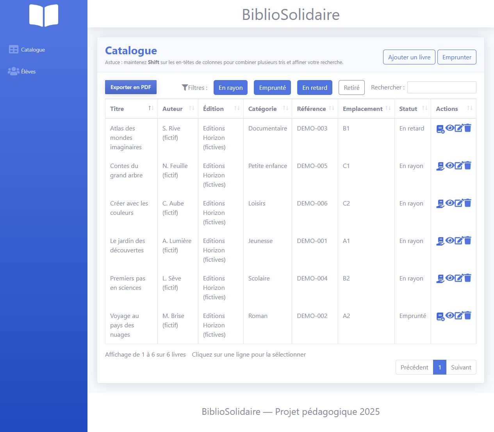
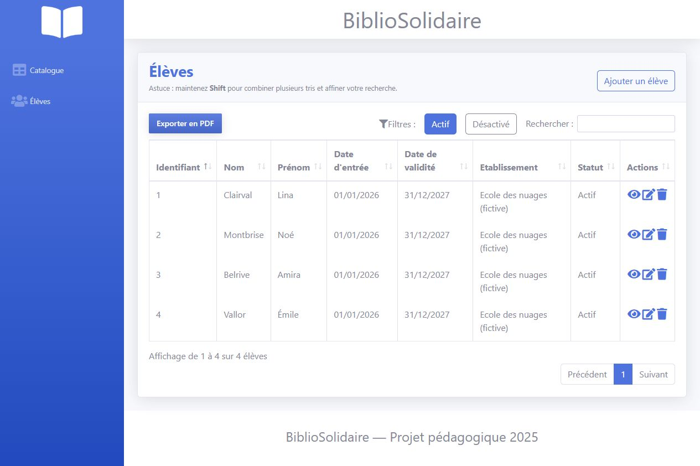
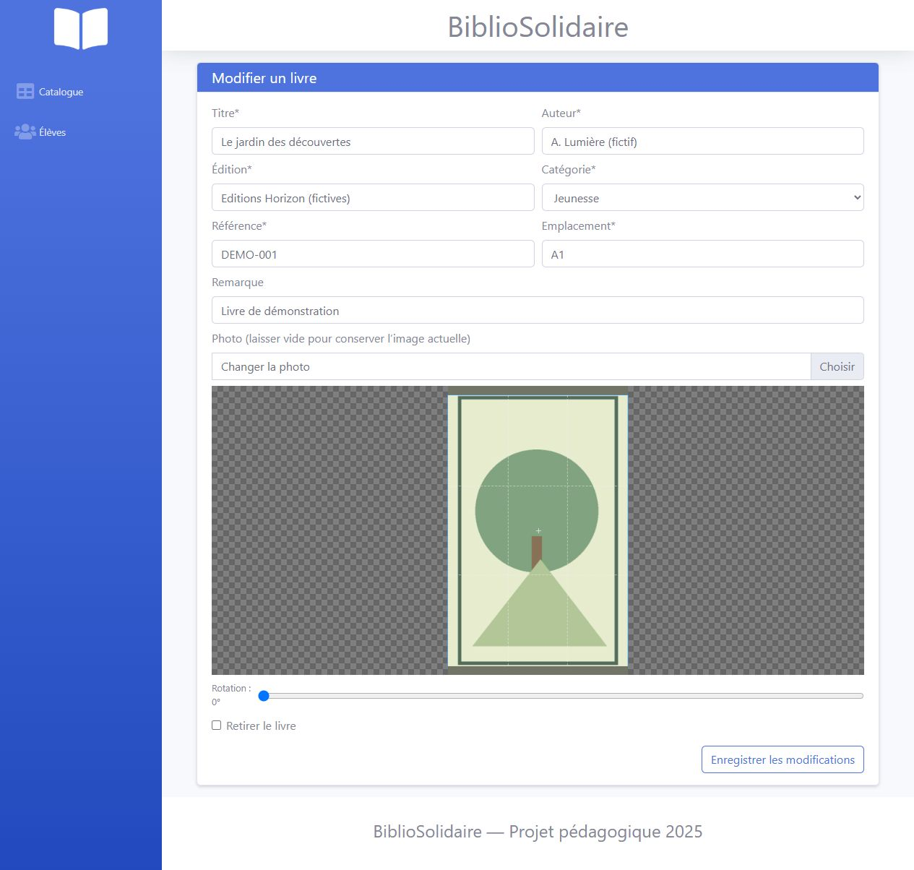
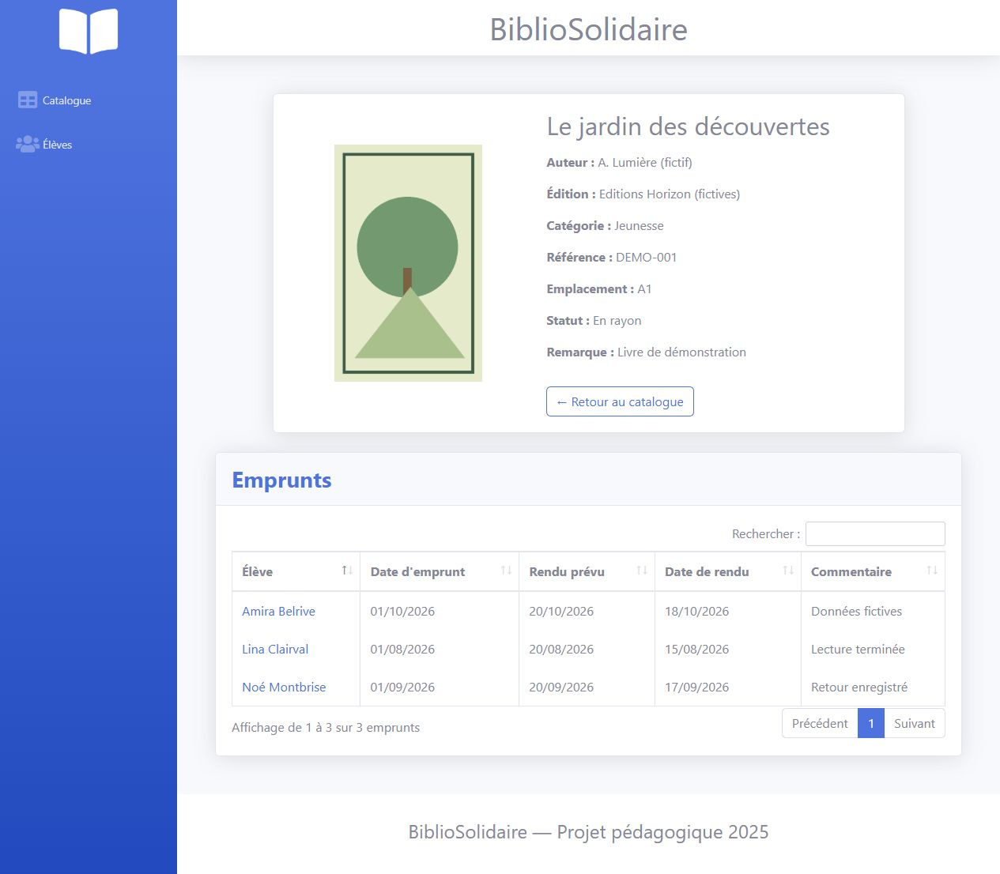

# BiblioSolidaire

**Offline library management web application — PHP, MySQL and JavaScript**

I built BiblioSolidaire in May 2025 as my final individual practical project (TPI) at ETML, for my Swiss Federal VET Diploma (CFC) in IT. The project brief described a school library need connected to the African Puzzle association in Benin, where a reliable Internet connection could not be taken for granted.

The goal was to make everyday library tasks manageable on a local computer: keeping track of books and students, recording loans and returns, and identifying overdue books. I developed the application with a PHP/MySQL backend and an MVC structure, and documented the requirements, database design and tests as part of the TPI.

This repository contains a cleaned-up copy of the original project, with setup instructions and screenshots using fictional records.

## Screenshots

The screenshots were taken from the application running locally with fictional data.

| Book catalogue | Student management |
| --- | --- |
|  |  |
| **Book editing form** | **Book details and loan history** |
|  |  |

## Features

- Add, edit, search and manage books, categories and availability
- Manage student records and validity dates
- Record book loans and returns, view loan history and identify overdue loans
- Search, sort and filter tables, with PDF export
- Upload and crop book or student images (JPEG)

The original TPI also included SQL import/export using bundled Windows MySQL executables. That functionality is disabled in this public version; PDF export remains available.

## Tech stack

- **Backend:** PHP, PDO, MySQL
- **Frontend:** HTML, CSS, JavaScript, Bootstrap 4 (SB Admin 2), jQuery
- **Libraries:** DataTables, pdfmake, Cropper.js, Font Awesome

## Project structure

The original MVC organization has been kept:

```text
index.php             Entry point
routes/               Routing
controller/           Application actions
model/                Database access and image handling
view/                 Pages and forms
ressources/           Local styles, scripts, fonts and images
database/schema.sql   Database schema
```

## Run locally

You will need PHP with the PDO MySQL extension enabled and a local MySQL server. UwAmp, which I used for the original project, is not required.

1. Create a MySQL database named `db_bibliosolidaire` with `utf8mb4` encoding, and a dedicated local user with access to it.
2. Import [`database/schema.sql`](database/schema.sql) into that database.
3. In the PowerShell session you will use to launch PHP, set your database connection values:

   ```powershell
   $env:BIBLIO_DB_HOST = '127.0.0.1'
   $env:BIBLIO_DB_PORT = '3306'
   $env:BIBLIO_DB_NAME = 'db_bibliosolidaire'
   $env:BIBLIO_DB_USER = 'your_local_user'
   $env:BIBLIO_DB_PASSWORD = 'your_local_password'
   ```

4. From the project folder, start PHP's local development server:

   ```powershell
   php -S 127.0.0.1:8000
   ```

5. Open `http://127.0.0.1:8000/` in your browser.

The database starts empty; the fictional records shown in the screenshots are not included. PHP needs write access to `ressources/img/book/` and `ressources/img/student/` to save uploaded images.

## Limitations

This is a school project from 2025, not a production-ready application. **It should only be run in a trusted local environment, never exposed directly to the Internet.** In particular, it has no authentication or authorization system, incomplete CSRF protection, some state-changing GET actions and inconsistent output escaping.

SQL import/export is unavailable in this version. Database backups and restores need a separate local MySQL tool; the original export/import workflow did not restore uploaded images.

The application was tested with PHP 8.0.1 and MySQL 5.7.11. Compatibility with newer releases and every interface path has not been verified. The required interface assets are bundled locally, although a test with the computer physically disconnected from the Internet was not performed. See [the validation notes](docs/VALIDATION.md) for the tests actually run.

## Notes

BiblioSolidaire was developed as an individual school project within the time allowed for the TPI. This repository retains the application while removing personal data, machine-specific files and assets with uncertain redistribution rights. It does not claim that the software was deployed or used by a school in Benin.

The full TPI report is not included. [Publication and asset notes](docs/PUBLICATION_REVIEW.md) explain the changes made to the original, and [third-party credits](THIRD_PARTY.md) document the included libraries and their licenses. The original project code has no project-wide license.
